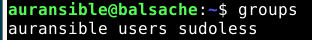
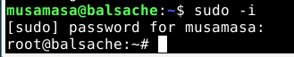
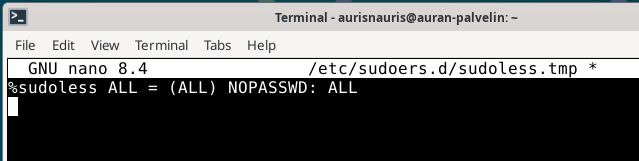

---
---



# h2 Voileipä

## Lue ja tiivistä
### Sudo without a password
Lähde: [terokarvinen.com](https://terokarvinen.com/passwordless-sudo/) Luettu: 9.11.2026

```
sudo visudo /etc/sudoers.d/sudoless -> tiedosto, jonne säännöt lisätään
%sudoless ALL = (ALL) NOPASSWD: ALL eli:

%sudoless = käyttäjäryhmä nimeltä sudoless
ALL = millä hostilla sääntö käytössä
= (ALL) = mikä ryhmä ja käyttäjä, komentoja saa suorittaa myös root-käyttäjänä
NOPASSWD: = poistaa salasanakyselyn
ALL = komennot, joita saa ajaa, eli kaikki.
```
Kaikki ryhmän %sudoless jäsenet voivat ajaa mitä tahansa komentoa millä tahansa käyttäjällä ilman salasanaa.  
- Luodaan käyttäjä
- Luodaan ryhmä (sudoless)
- Lisätään käyttäjä ryhmään  
Lisätään backdoor varmuuden varalta:  
- SSH kohdekoneeseen
- sudo -i -> käynnistää kirjautumisshellin rootina
- Jätä root-shell taustalle ja palaa "normaaliin" ikkunaan  
Testaus
- Kirjaudu uudelta sudoless-käyttäjältä ulos ja takaisin sisään
- Kokeile ssh-yhteyden luominen (ei pitäisi tulla salasanakyselyä) ja esim. sudo echo-komento, joka testaa oikeuksia
- sudo -k unohtaa kirjautumistiedot, jos ne on vielä sudon muistissa

### Sandwich
Lähde: https://xkcd.com/149/ Luettu: 9.11.2026  

   
Kuvassa tiivistetään sudo-komennon ylivalta ja edellinen teksti liittyy ehkä siltä osin, ettei sudo-käyttäjää todenneta mitenkään.

### Passwordless Sudo with Ansible
Lähde: [terokarvinen.com](https://terokarvinen.com/passwordless-sudo-with-ansible/) Luettu: 9.11.2026   
Ohjeessa kerrotaan, miten toteutaan IaC-versio salasanattomasta sudo-kirjautumisesta niin, että sen saa laajaankin koneympäristöön toimimaan. Ensin luodaan rooli (roles), jolle luodaan tehtävä (tasks) nimeltä main.yml. Yaml-tiedostoon lisätään mm. SSH-avain ja ykköstekstistä tuttu:   
    dest: "/etc/sudoers.d/sudoless"
    content: "%sudoless ALL = (ALL) NOPASSWD: ALL\n"   
Tämä task ajettaessa, kopioituu kansioon **/etc/sudoers.d/sudoless** sisältö **%sudoless ALL = (ALL) NOPASSWD: ALL\n** seuraavilla tarkennuksilla:
owner: "root" -> tieodston omistaa root
group: "root" -> tiedoston ryhmä on root
mode: "0644 -> tiedoston oikeudet oktaalilukuina   
**0644** -> 6, luku + kirjoitus & 4, vain luku   

### Ansiblen sisäänrakennettu dokumentaatio ansible-doc-komennolla

# Tehtävät
## a) Sudoless.
Tehty suoraan ohjeiden (https://terokarvinen.com/passwordless-sudo/) pohjalta. Ensin testattu ssh-yhteys palvelimelle nimeltä balsache, jossa käyttäjä musamasa. Sitten loin musamasan kaveriksi käyttäjän auransible ja ryhmän sudoless, ja lisäsin auransiblen siihen.  
  
Avataan backdoor (jos rikon sudon, niin pääsen silti sisään) 
  
Sitten muokkasin .d-hakemistoon tiedoston sudoless, ja iskin säännön **%sudoless ALL = (ALL) NOPASSWD: ALL** sinne. Tämä luvittaa kaikki ryhmän sudoless käyttäjät kirjautumaan ilman salasanaa.
Lopuksi testaus, eli testasin ottaa ssh- yhteyden auransible-käyttäjällä localhostiin ja tehdä sudo echo-komennon. Tämä ei pyytänyt salasanaa, joten kaikki toimii:  
   

