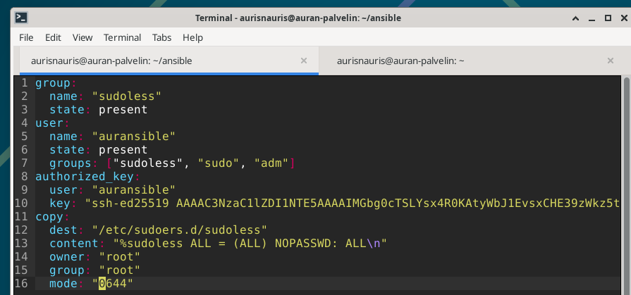
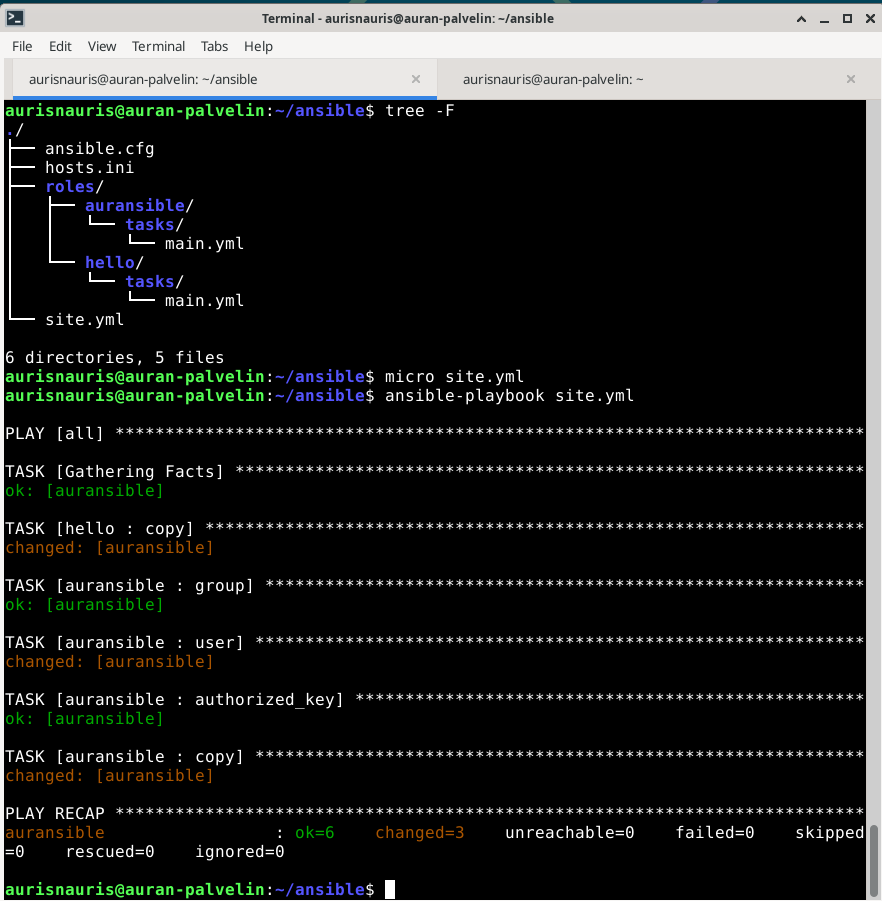
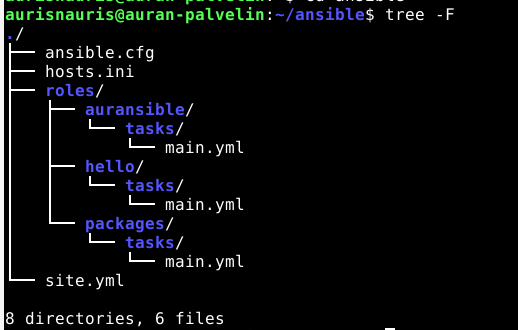
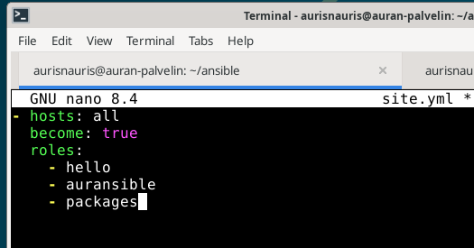
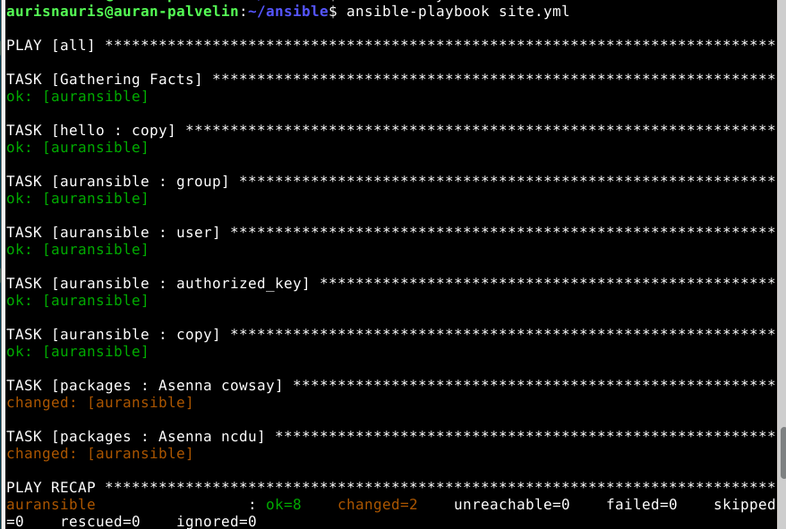
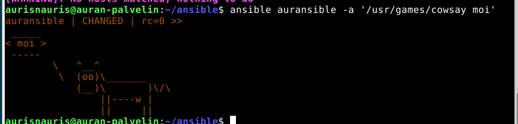
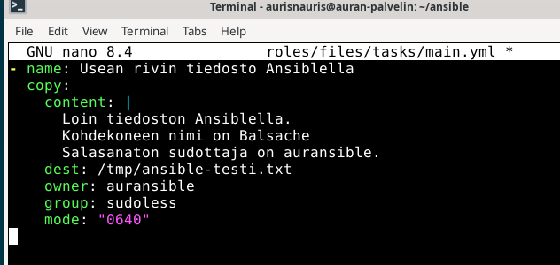
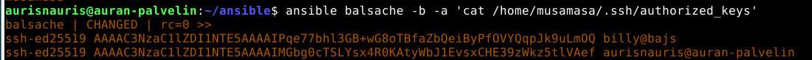

---
---



# h2 Voileipä

## Lue ja tiivistä
### Sudo without a password
Lähde: [terokarvinen.com](https://terokarvinen.com/passwordless-sudo/) Luettu: 9.11.2026

```
sudo visudo /etc/sudoers.d/sudoless -> tiedosto, jonne säännöt lisätään
%sudoless ALL = (ALL) NOPASSWD: ALL eli:

%sudoless = käyttäjäryhmä nimeltä sudoless
ALL = millä hostilla sääntö käytössä
= (ALL) = mikä ryhmä ja käyttäjä, komentoja saa suorittaa myös root-käyttäjänä
NOPASSWD: = poistaa salasanakyselyn
ALL = komennot, joita saa ajaa, eli kaikki.
```
Kaikki ryhmän %sudoless jäsenet voivat ajaa mitä tahansa komentoa millä tahansa käyttäjällä ilman salasanaa.  
- Luodaan käyttäjä
- Luodaan ryhmä (sudoless)
- Lisätään käyttäjä ryhmään  
Lisätään backdoor varmuuden varalta:  
- SSH kohdekoneeseen
- sudo -i -> käynnistää kirjautumisshellin rootina
- Jätä root-shell taustalle ja palaa "normaaliin" ikkunaan  
Testaus
- Kirjaudu uudelta sudoless-käyttäjältä ulos ja takaisin sisään
- Kokeile ssh-yhteyden luominen (ei pitäisi tulla salasanakyselyä) ja esim. sudo echo-komento, joka testaa oikeuksia
- sudo -k unohtaa kirjautumistiedot, jos ne on vielä sudon muistissa

### Sandwich
Lähde: https://xkcd.com/149/ Luettu: 9.11.2026  

   
Kuvassa tiivistetään sudo-komennon ylivalta ja edellinen teksti liittyy ehkä siltä osin, ettei sudo-käyttäjää todenneta mitenkään.

### Passwordless Sudo with Ansible
Lähde: [terokarvinen.com](https://terokarvinen.com/passwordless-sudo-with-ansible/) Luettu: 9.11.2026   
Ohjeessa kerrotaan, miten toteutaan IaC-versio salasanattomasta sudo-kirjautumisesta niin, että sen saa laajaankin koneympäristöön toimimaan. Ensin luodaan rooli (roles), jolle luodaan tehtävä (tasks) nimeltä main.yml. Yaml-tiedostoon lisätään mm. SSH-avain ja ykköstekstistä tuttu:   
    dest: "/etc/sudoers.d/sudoless"
    content: "%sudoless ALL = (ALL) NOPASSWD: ALL\n"   
Tämä task ajettaessa, kopioituu kansioon **/etc/sudoers.d/sudoless** sisältö **%sudoless ALL = (ALL) NOPASSWD: ALL\n** seuraavilla tarkennuksilla:
owner: "root" -> tieodston omistaa root
group: "root" -> tiedoston ryhmä on root
mode: "0644 -> tiedoston oikeudet oktaalilukuina   
**0644** -> 6, luku + kirjoitus & 4, vain luku   

### Ansiblen sisäänrakennettu dokumentaatio ansible-doc-komennolla
**Ansible-doc copy**
**Johdanto:** Moduuli kopioi tiedoston paikalliselta tai etäkoneelta kohdekoneen sijaintiin.  
src: Paikallinen polku kopioitavaan tiedostoon. Jos polku on hakemisto, se kopioidaan rekursiivisesti.  
dest: Kohdekoneen absoluuttinen polku, johon tiedosto kopioidaan.   
content: Asettaa tiedoston sisällön suoraan annetuksi arvoksi, kun src-optiota ei käytetä.  
owner, group, mode: Group on ryhmän nimi, kuten chown:lle annettaisiin. Moden pitää olla oktaaliluku. Mode voi olla myös symbolinen, esim. u=rw,g=r,o=r.  
Esimerkki: tiedosto kopioidaan ja oikeudet asetetaan: src, dest, owner root, group root ja mode ‘0644’.  

**apt**
**Johdanto:** Hallitsee asennuspaketteja.  
name: Paketin nimi. Aliakset ovat package ja pkg.  
state: Haluttu paketin tila. Vaihtoehdot: build-dep, latest, present (oletus) ja fixed. Esimerkeissä absent poistaa paketin.  
update_cache: Ajaa apt-get update:n ennen toimintoa. Oletuksena välimuistia ei päivitetä.  
Esimerkki: Apache asennetaan antamalla name: apache2 ja state: present. Tila present on oletus, joten sen voi jättää pois.  

**file**
**Johdanto:** Tiedostonhallinta sekä niiden ominaisuuksien hallinta.  
path: Hallittavan tiedoston polku, pakollinen.
state: Tiedoston tila, esim. absent.
recurse: Asettaa hakemiston sisällölle attribuutit rekursiivisesti (eli täydentäen itse itseään, tai kutsuu itseään ajon aikana).  
src: Linkin polku.  
owner, group, mode: Samat kuin copy-moduulissa.  
Esimerkki: Hekmisto (directory) luodaan antamalla path, state: directory ja mode, esim. 0644.  

**user**
**Johdanto:** Hallinnoi käyttäjätilejä.  
name: Käyttäjän nimi (pakollinen)
create_home: Luo kotihakemiston  
comment: Tilin kuvaus  
groups: Lista käyttäjän ryhmistä. Jotta käyttäjää ei poisteta muista ryhmistä, kuin mihin häntä ollaan lisäämässä, on lisättävä append:true.  
shell: Käyttäjän shell eli komentotulkki  
state: Käyttäjän tila. Voi olla present tai absent  
system: järjestelmätili, joka luodaan tilin luonnin yhteydessä  
esimerkki: käyttäjä aura saa bash-shellin(komentotulkki) ja ryhmän sudoless  

**authorized_key**
**Johdanto:** Lisää tai poistaa ssh-avaimia käyttäjiltä.  
key: Julkinen/julkiset ssh-avaimet, esim. merkkijonona hipsuissa tai tieodstopolkuna.  
user: Käyttäjänimi etäkoneella, kenen avaintiedostoa muokataan.  
Esimerkki: käyttäjän auransible ssh-avain vaihdetaan uuteen.  

# Tehtävät
## a) Sudoless.
Tehty suoraan ohjeiden (https://terokarvinen.com/passwordless-sudo/) pohjalta. Ensin testattu ssh-yhteys palvelimelle nimeltä balsache, jossa käyttäjä musamasa. Sitten loin musamasan kaveriksi käyttäjän auransible ja ryhmän sudoless, ja lisäsin auransiblen siihen.   
  
Avataan backdoor (jos rikon sudon, niin pääsen silti sisään)  
  
Sitten muokkasin .d-hakemistoon tiedoston sudoless, ja iskin säännön **%sudoless ALL = (ALL) NOPASSWD: ALL** sinne. Tämä luvittaa kaikki ryhmän sudoless käyttäjät kirjautumaan ilman salasanaa.  
Lopuksi testaus, eli testasin ottaa ssh- yhteyden auransible-käyttäjällä localhostiin ja tehdä sudo echo-komennon. Tämä ei pyytänyt salasanaa, joten kaikki toimii:  
   

Kävin vielä kopioimassa uudelle käyttäjälle, auransible, ssh-avaimen, eli **ssh-copy-id** auransible@balsachen-ip-osoite.  

## b) Salasanaton, automaattisesti ssh:lla kirjautuva tunnus Ansiblella.
En ihan ymmärtänyt, miksi sama piti tehdä toistamiseen, tehtävänanto ei ollut kovin selkeä asiassa. Mutta tämänkin tein ohjeiden mukaan. Vaikka ohjeissa varotti, että valittaa sudo:n tarvitsevan salasanaa, se ei minulta pyytänyt sitä. Varmaan, koska tämä käyttäjä oli jo tehty ns. lokaalisti ilman ansiblea. ( https://terokarvinen.com/passwordless-sudo-with-ansible/ )
   
   

## c) Package
Loin ensin roolin Packages paketeille:  
```
   

```
ja sen tasks/main.yml:iin **nano:**
```
- name: Asenna cowsay -> tulostaa tekstin lehmän puhekuplaan
  ansible.builtin.apt:
    name: cowsay
    state: present
    update_cache: true -> päivittää pakettilistan

- name: Asenna ncdu -> levytilan käytön selaus
  ansible.builtin.apt:
    name: ncdu
    state: present
```
Lisäsin uuden roolin packages **site.yml**:iin:  
   
ja kun ajoin **ansible-playbook site.yml** niin muutokset tulivat voimaan sekä paketit ajettiin:   
   
Sitten oli pakko testata tuo cowsay, koska se vaikutti hauskalta:  
   
Toisen paketin asennuksen testasin ajamalla uudelleen **ansible-playbook site.yml**. Koska mitään ei ollut tilassa changed, tarkoittaa, että playbook on idempotentti.  

## d) File
Loin roolin files:
```
mkdir -p roles/files/tasks/main.yml

nano roles/files/tasks/main.yml
```
ja sitte seuraavanlaista tekstiä:  
   
Tämä käyttää Ansiblen copy-moduulia ja kopioi content-kohdan tekstin tiedostoon /tmp/ansible-testi.txt.  
Tiedoston omistaja on auransible ja ryhmä sudoless.  
Oikeudet 0640:  
Omistaja (auransible) read/write-  
Ryhmä (sudoless) read--  
Muut ---

|-merkki on literal block ja kertoo että annettu sisältö toistetaan sellaisenaan, eli rivinvaihdot säilyvät.  
Sitten lisäsin site.yml:iin roolin files, jotta tiedosto ajetaan playbookin yhteydessä.  
Ajoin testiksi **ansible balsache -a 'ls -l /tmp/ansible-testi.txt'**:  
  
Ja komennolla **ansible balsache -a 'cat /tmp/ansible-testi.txt'** saatiin tiedoston sisältö näkyviin:  
  

## e) Jotain muuta, katsellaan avaimia
Seuraavalla komennolla nähdään, mitä .ssh-avaimia löytyy musamasa-käyttäjän tiedostoista, balsache-nimisellä NUC-koneella:  
```
ansible balsache -b -a 'cat /home/musamasa/.ssh/authorized_keys' -> -b=become: true eli pääsen rootilla katsomaan tiedostoja
```
Sieltä löytyi kaksi avainta, joista toista en tiedä todellakaan kenen se on :O Pitää varmaan poistaa se kun jaksaa...  
  

------------------------------------------------  

## Lähteet:
https://terokarvinen.com/passwordless-sudo-with-ansible/ Luettu 9.11.2026  
https://terokarvinen.com/passwordless-sudo/ Luettu 9.11.2026

Kumppani Mats
Claude.ai termien selitykseen


