---
---



# h3 Demoni

## x) Lue ja tiivistä
### Apache installed with Ansible - quick notes | Lähde: https://terokarvinen.com/apache-ansible/ | Luettu: 14.11.2026
Apache2 on web-demoni, joka toimittaa verkkosivuja käyttäjän selaimeen.  
```
package - sudo apt-get install apache2 -> Apache2-paketin asennus
files - sudoedit /etc/apache2/... -> sudoedit avaa tekstieditorin sudo-oikeuksilla
service - sudo systemctl restart apache2 -> käynnistää demonin
```
Ansiblessa Apachelle määritetään, samalla tavalla kuin muillekin taskeille, omistaja, ryhmä ja oikeudet.  
Handler- eli käsittelijä- hoitaa Apachen uudelleenkäynnistyksen eli 'potkaisun'.  
Apache- tiedostoihin voidaan laittaa sivuohjauksia ja konfiguraatioita.

### Handlers: running operations on change | Lähde: https://docs.ansible.com/projects/ansible/latest/playbook_guide/playbooks_handlers.html | Luettu: 14.11.2026  
Käsittelijät (handlers) ovat tehtäviä, jotka ajetaan vain silloin, kun jokin toinen tehtävä muuttaa jotain ja herättää ne (notify). Ne ajetaan siinä järjestyksessä, jossa ne on listattu tiedostossa, ja kukin vain kerran. 
Näin turhia ajoja ei tehdä, järjestelmien kuormitus pysyy pienenä ja lokista näkee selvästi, milloin muutos on tehty.  

### 'ansible-doc service'
Johdanto:  Moduuli toimii välityspalvelijana (proxy) useille palvelunhallintamoduuleille, kuten systemd:lle. Moduuli määräytyy use-asetuksen mukaan. Oletuksena se on ansible.builtin.setupin tunnistama palvelunhallinta.  
Enabled:  Boolean-arvo (True/False) kertoo, käynnistyykö palvelu käynnistyksessä. On pakko määritellä ainakin state tai enabled.  
Name:  Palvelun nimi on pakollinen, merkkijono  
State:  Started, stopped, restarted tai reloaded, kuvaa halutun palvelun tilan. Started ja stopped ovat idempotentteja, eli ne eivät aja komentoja, ellei se ole tarpeen. Restarted käynnistää palvelun aina uudelleen. Reloaded lataa asetukset aina uudetsaan ja käynnistää palvelun (jos se ei ole käynnissä).  
Esimerkki:  Verkkopalvelun uudelleenkäynnistys.

## y) Uutinen Hacker Newsistä
### Lähde: https://news.ycombinator.com/ -> En löytänyt mitään ja motivaatio loppui

## a) Apassi.
### Ohje: https://terokarvinen.com/apache-ansible/
Asensin ensin käsin auran-palvelin- koneeseen Apache2:
```
sudo apt-get update
sudo apt-get install apache2
```
Tein kotihakemistoon sivun, johon ei tarvitse sudo-oikeuksia muokkaukseen:
```
mkdir ~/publicsite
echo "Hei maailma" > ~/publicsite/index.html
chmod a+x ~ 
```
**Chmod**= muokkaa oikeuksia  
**a**= all, kaikki omistajat, ryhmät käyttäjät  
**+x**= ajo-oikeus  
**~**= kotihakemisto, eli kohde, mihin oikeudet muutetaan 
Oikeudet pitää antaa, jotta Apache pääsee kotihakemistoon pyörimään.  
Lisäsin sivun asetukset:
```
sudoedit /etc/apache2/sites-available/example.com.conf
```  
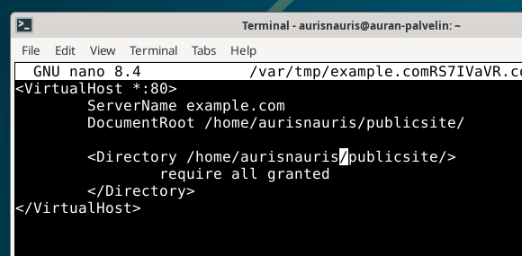  
Oma sivu pitää ottaa käyttöön localhostiin:
```
sudo a2ensite example.com.conf -> uusi sivu
sudo a2dissite 000-default.conf -> vanhan sivun poisto
sudo systemctl restart apache2 -> demonin potkaisu
```
Sain muokattua uutta localhost- oletussivua ilman sudo-oikeuksia ja kaikki kunnossa:  
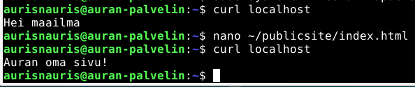  
### Apache2 Ansible-rooliksi
```
cd ansible
mkdir -p roles/apache2/{tasks,handlers,files}
```
Siirryin Ansible-hakemistoon ja loin sinne Ansiblelle roolin, käsittelijät-kansion ja tehtävät-kansion.  
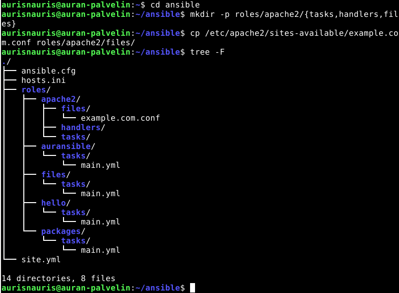  
Katsottu Teron ohjeesta main.yml-asetukset.  
Ensin tasks/main.yml:  
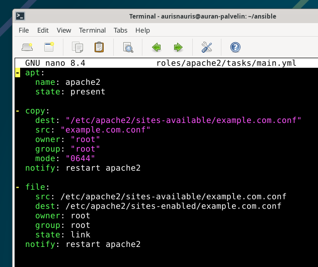  
Sitten handlers/main.yml, joka kertoo, milloin demonia 'potkaistaan':  
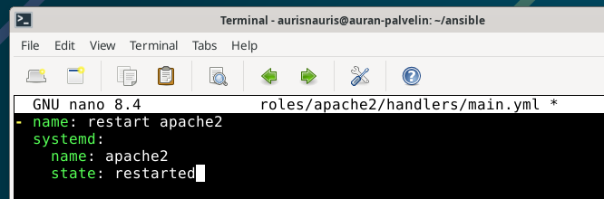   
Lopuksi lisäsin apache2:sen site.yml-tiedostoon, jotta se huomioidaan playbookin ajon yhteydessä. Sen jälkeen playbookin ajo kahteen kertaan, joista jälkimmäisellä ei näy enää muutoksia.  
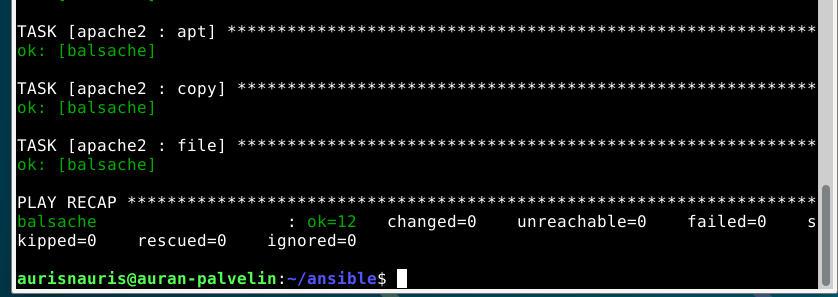  

## b) Moottorix
Sammutin Apachen, sillä muuten ne riitelevät Nginxin kanssa portista 80:  
```
sudo systemctl disable --now apache2
``` 
ja asensin Nginx:
```
sudo apt-get update
sudo apt-get install nginx
```
Tein uuden hakemiston Nginxille, jotta pysyy selvänä, mikä demoni täällä pyörii:
```
mkdir -p ~/nginxsite
echo "Auriksen oma Nginx" > ~/nginxsite/index.html
```
Nginx käyttää erilaista syntaksia kuin Apache2. Apachessa lohkot eritellään avaus- ja sulkutägeillä (<, />), kun taas Nginx:ssä on aaltosulut({}).  
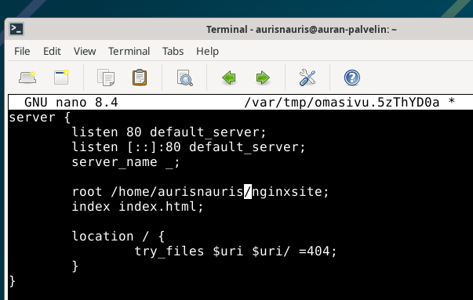   
Vaihdetaan default-sivu omaksi sivukseni:  
```
sudo ln -s /etc/nginx/sites-available/omasivu /etc/nginx/sites-enabled/omasivu
sudo rm /etc/nginx/sites-enabled/default
```
Tarkistetaan asetussivun syntaksit ja potkaistaan käyntiin:
```
sudo nginx -t
sudo systemctl restart nginx
```
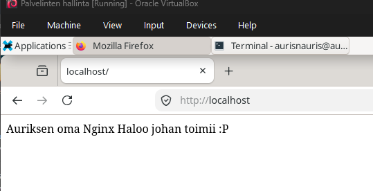  
Lopuksi testasin vielä, että oletussivun muuttaminen toimii ilman sudo-oikeuksia. Tämähän toimi, sillä oikeudet oli asetettu jo Apachen yhteydessä.  
Katsoin myös komennolla **systemctl is-active apache2** että toinen selaindemoni oli sammunut.  
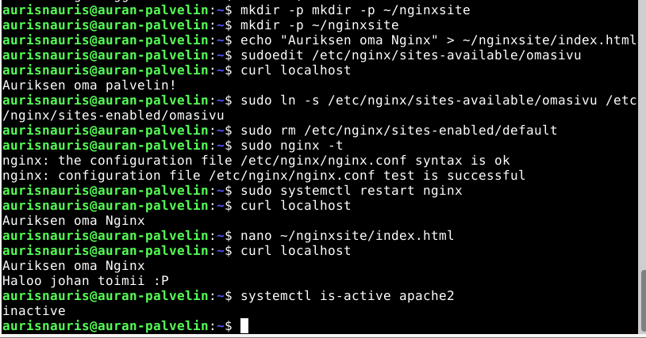   

## c) Automoottorix
Toistin kaikki samat stepit kuin ylempänä kohdassa Apache2 Ansible-rooliksi, mutta Apache2-nimen sijaan laitoin nginx. 
Kysyin Claudelta apua tarkistamaan tekemäni Nginx-tehtävätiedoston, komennolla _"vertaa alla olevaa ansible-asetustiedostoa kuvakaappauksen apache2:lle tehtyyn tiedostoon. Nosta esiin korjauksia."_  
Tiedostoon korjattiin siis nimeen Nginx, tiedostosijainnit ja -nimet. 
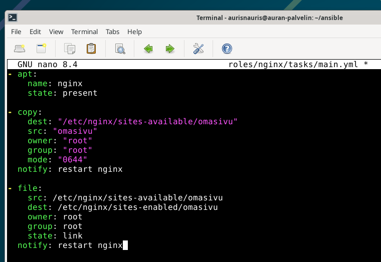   
Käsittelijään **roles/nginx/handlers/main.yml** laitettiin:
```
- name: restart nginx
  systemd:
    name: nginx
    state: restarted
```
Claude nosti esiin vielä sellaisen asian, että kun Nginx asennetaan, Debian luo automaattisesti oletussivun sites-enabled/default, joka kuuntelee porttia 80. Se on merkattu default_server-sivuksi, joten se on poistettava, ettei tule oman sivustoni päälle. Käsin tehtynä tämä löytyy ylempää kohdasta b).  
Tämän pohjalta lisäsin tiedostoon roles/nginx/tasks/main.yml:in loppuun:
```
- file:
    path: /etc/nginx/sites-enabled/default
    state: absent
  notify: restart nginx
```
Lopuksi vielä site.yml-tiedostoon lisätään nginx ja ajetaan **ansible-playbook site.yml**. Sain ensimmäisessä ajossa isoa erroria:
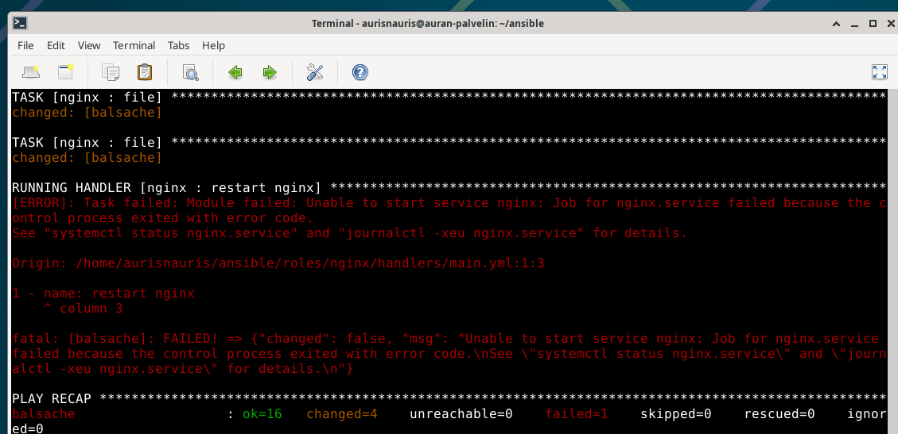
Kysyin Claudelta ja hän epäili, että Apache varaa kohdekoneella yhä portin 80. Tekoälyn ohjeiden avulla laitoin tasks/main.yml-alkuun Apachen pysäyttävän tehtävän: 
```
- systemd:
    name: apache2
    state: stopped
    enabled: false
```
Olin pysäyttänyt Apachen pelkästään pääkoneella 'auran-palvelin', enkä kohdekoneella 'balsache'...  

--------------------------------------------------------------  
Lähteet:  
https://terokarvinen.com/apache-ansible/ Luettu viim. 17.11.2026  
https://docs.ansible.com/projects/ansible/latest/playbook_guide/playbooks_handlers.html#notifying-handlers Luettu viim. 17.11.2026  
Claude.ai, promptit annettu tehtävässä  


