---
---



#h4 Pizza fantasia
## Tiivistys. Lähde: Tero Karvisen väitöskirja vuodelta 2024
### 4.12.1 Size and Complexity of Some DSLs
- Hajautetut järjestelmät voivat kasvaa todella monimutkaisiksi ja isoiksi
- Saltissa on 510 tilafunktiota, joilla voi hallita kohdekoneita
- Puppetissa on valmiina 113 funktiota
- Puppet pohjautuu resurssien ja niiden suhteiden määrittelyyn, hyödyntää verkkoresursseja
### 4.12.2 Use of DSL Functions in Case Configuration
- Tero analysoi ensin julkista Puppet-tuotantokonfiguraatiota: Yhdysvaltain hallituksen konfiguraatiopohjaa (USGCB) ja Mozillan Release Engineering -manifesteja
- Mozilla: eniten käytettyjä komentoja ovat:
      - case, file, package, exec ja service
- Puppet käyttää if- ja case- rakennetta, sekä class (eri kuin ohjelmoinnissa). Ankkureilla (anchor) hallitaan riippuvuuksia.
- USGCB:n yleisimmät funktiot ovat augeas, file, service, exec ja package
### 4.12.3.1 Dependencies Between Main Functions
- Daemonin pystytys tehdään funktioilla package, file ja service, sovellusten pystytys funktioilla package ja file
- Käyttäjien hallintaan kuuluvat user ja group, ja tiedostojen käsittelyyn file, directory ja symlink
- Muutokset tehdään vain, jos järjestelmä ei ole jo halutussa tilassa
- Tiedostoilla on monta attribuuttia (sisältö, oikeudet, omistaja), joten filet kannattaa toteuttaa itse eikä kutsua ulkoista ohjelmaa

## a) Räpylä
Valitsin asennettavaksi PostgreSQL-tietokannan, koska Tero antoi siihen tunnilla luvan.  
Ensin PostgreSQL-moduulien asennus:
```
ansible-galaxy collection install community.postgresql
```
- **ansible-galaxy collection install:** asentaa Ansible-kokoelman, eli joukon moduuleja, joita ei tule mukana perusasennuksessa.  
- **community.postgresql:** yhteisön ylläpitämä kokoelma, jossa on moduulit esim. tietokannan (postgresql_db) ja käyttäjän (postgresql_user) luontiin.
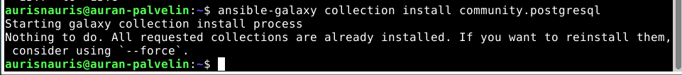  
Luotiin roolille hakemistot samalla lailla kuin Apachessa ja Nginxissä:
```
cd ~/ansible
mkdir -p roles/postgre/{tasks,handlers,files}
```
### Tasks/main.yml
Kirjoitin tehtävät(tasks) samantyyppiseen muotoon kuin Apache-tehtävässä, tiedostoon postgre/tasks/main.yml.    
Ainoa ero on, että PostgreSQL-moduuleista pitää käyttää koko nimeä, koska ne tulevat kokoelmasta.  
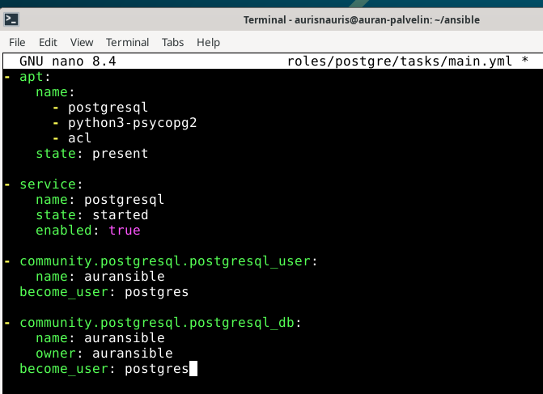  
- **postgresql:** itse tietokantapalvelin.
- **python3-psycopg2:** Python-kirjasto, jonka avulla Ansible puhuu PostgreSQL:n kanssa. 
- **acl:** tarvitaan, jotta Ansible voi vaihtaa käyttäjäksi postgres (become_user) ilman root-oikeuksia tilapäistiedostojen käsittelyyn
- **service:** varmistaa, että palvelu on halutussa tilassa koneen käynnistyttyä
- **become_user: postgres:** PostgreSQL:n pääkäyttäjä on Linux-käyttäjä postgres
Debianin PostgreSQL käyttää oletuksena niin sanottua peer2peer-autentikointia paikallisissa yhteyksissä.  
Silloin, kun Linux-käyttäjän ja PostgreSQL-käyttäjän nimi on sama, salasanaa ei tarvita ollenkaan.  

### Handlers/main.yml
Käsittelijä tehty Apache-mallin pohjalta, laitoin sen varalle jos joskus tarvitsee:
```
- name: restart postgresql
  systemd:
    name: postgresql
    state: restarted
```
### Site
Lisäsin uudel roolin **postgre** site.myl-listaan:
```
- hosts: all
  become: true
  roles:
    - hello
    - auransible
    - packages
    - files
    - apache2
    - nginx
    - postgre
```
Ja playbookin ajo:
```
cd ~/ansible
ansible-playbook site.yml
```
Unohdin ottaa kuvan, mutta alla näkyy idempotenssi ja onnistuneet muutokset:  
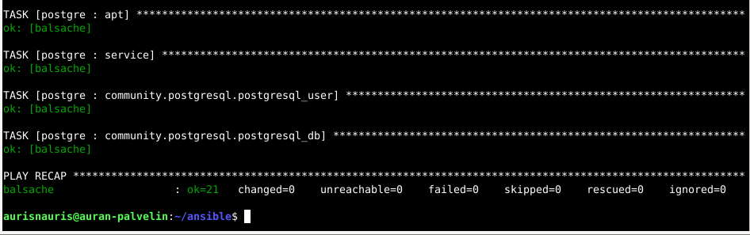  

### Testaus kohdekoneelle
Ensimmäinen yritys tarkistaa tietokanta meni väärin, sillä kirjoitin **psql** suoraan auran-palvelin-koneella. Se avasi kontrollerin oman PostgreSQL:n tietokannan aurisnauris, ei balsachen.  
Ansible oli asentanut tietokannan balsachelle, joten sinne pitää kirjautua ensin:
```
ssh auransible@balsache
psql
```
SSH:ssa tuli lisäksi varoitus locale-asetuksista, koska auran-palvelin lähettää suomenkieliset kieliasetukset (fi_FI.UTF-8), joita balsachelle ei ole generoitu.  
Se ei vaikuta PostgreSQL:n tai Ansiblen toimintaan, joten jätin sen huomiotta.  
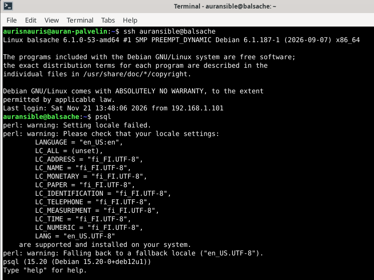   
Roolit tarkistin psql-kehotteella **\du**:
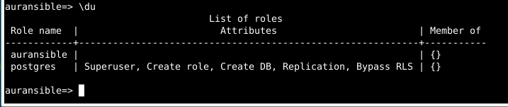   

## c) Asetus
Loin uuden tiedoston sijaintiin **roles/postgre/files/auransible.conf**  
Lisäsin sinne **max_connections = 60**. Max_connectionin oletus on 100, joten helpolla muutoksella saa muutoksen näkyviin.  
Tiedostoon **roles/postgre/tasks/main.yml** lisäsin tehtävän auransible.conf-tiedostolle:  
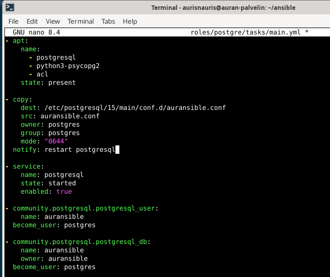  
Ja tarkistin, että /postgre/handlers/main.yml:ssä on asetettu haluttu tila, restarted, postgresql:lle.  
Ajo **ansible-playbook site.yml** ja max_connectionsien tarkistus:  
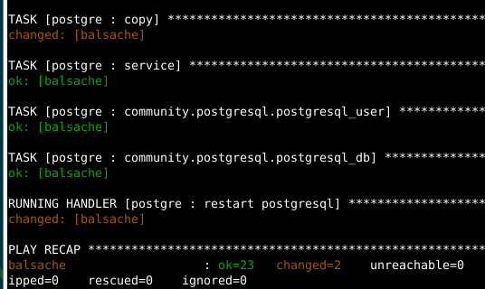   
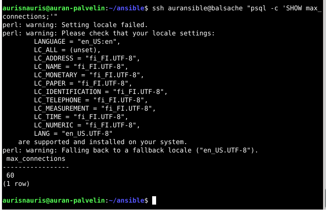  
Jälkimmäisessä näkyy max_connections ------- 60 (1 row) ja idempotenssi tarkistettu ajamalla playbook uusiksi.

## d) Paikka remonttiin
### Ensin kohdekoneella poistaminen
Kirjauduin ssh auransible@balsache ja purgetin postgreSQL:
```
sudo apt-get purge postgresql-15
```
Ja kaikkeen vain kyllä kyllä, kaikki pois:  
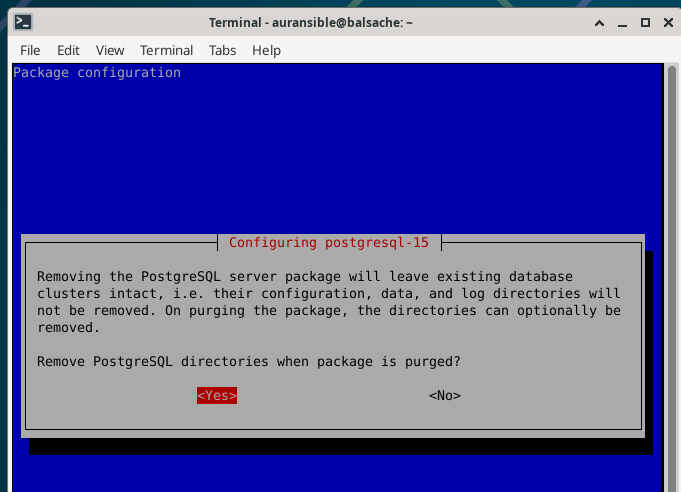  
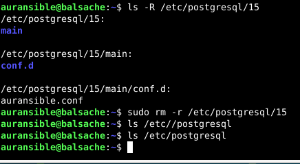  
Purgen lisäksi tein **sudo rm -r /etc/postgresql/15**, jotta tekemäni tiedosto lähtee myös pois.  

### Korjaus pääkoneelta
```
cd ~/ansible
ansible-playbook site.yml
```
  

## e) Idempotentti
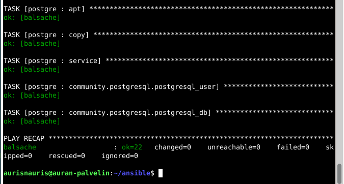  
------------------------------------------------------
# Lähteet:
Configuration Management of Distributed Systems over Unreliable and Hostile Networks, Karvinen Tero, 2024 (https://westminsterresearch.westminster.ac.uk/item/w7vvz/configuration-management-of-distributed-systems-over-unreliable-and-hostile-networks, Luettu: 24.11.2024)
Claudelta kysytty "Vertaa antamani ansible-postgresql-yml. tiedosto aiemmin tekemääni tiedostoon, kerro huomiot" ja "Miten näytän, että asetus on ajettu?".
